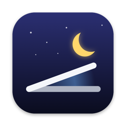

# NgaemBook (แง้มบุ๊ค)

A macOS menu bar app for a MacBook lid that is only a little open ("แง้ม" means "ajar" in Thai).
When the lid folds below an angle (25° by default), NgaemBook sleeps the display and turns off the keyboard backlight.
Open the lid again and both come back. The Mac itself stays awake, so downloads, music and servers keep running.

It has no window and no Dock icon: everything is in the menu bar item.

## Install

Download the `.dmg` from [Releases](https://github.com/narze/NgaemBook/releases), open it, and drag NgaemBook to Applications.
The app is not notarized: the first time, right-click the app and select **Open**
(or run `xattr -dr com.apple.quarantine /Applications/NgaemBook.app`).

## Run

Needs macOS 14+ and a MacBook with a lid angle sensor (2019 MacBook Pro 16" and later; some M1 models do not have one).

```sh
swift run NgaemBook          # from source
scripts/bundle.sh            # build/NgaemBook.app (universal, ad-hoc signed)
scripts/dmg.sh               # build/NgaemBook-<version>.dmg
scripts/make-icon.sh         # redraw the logo (scripts/icon.swift) into Resources/AppIcon.icns
swift test
```

## Menu

- **Fold Below** - the angle (10° to 60°). The lid counts as open again at this angle + 3°, so the display does not flicker at the limit.
- **Sleep Display** - sleep the display when folded. If a touch wakes the screen while the lid is still folded, it sleeps again after 3 seconds.
- **Keep Display On with External Display** - on by default. Display sleep turns off all displays, so NgaemBook does not sleep them when an external display is connected. The keyboard backlight still turns off.
- **Turn Off Keyboard Backlight** - turn it off when folded, and restore the level and auto-brightness when open.
- **Launch at Login**, **Enabled**, **Quit**.

## Battery

The lid sensor can push values, but it sends 10 reports per second even when the lid does not move.
So NgaemBook polls at a variable rate instead: once per second when the lid is far from the angle, 4 times per second within 20° of it, and 2 times per second while folded.
Timer leeway lets macOS group these wakeups with others. No reads happen while paused or while the Mac sleeps.

## Notes

- If macOS asks for your password after the display turns off, folding locks the Mac, as closing the lid does.
- The keyboard backlight uses the private CoreBrightness framework (there is no public API). If a macOS update removes it, the menu item turns gray and the display part still works.
- The lid sensor is a HID device (vendor `0x05AC`, product `0x8104`, usage page `0x20`, usage `0x8A`); feature report 1 holds the angle in degrees. The sensor code comes from [MacBook Protractor](https://github.com/narze/MacBook-Protractor).
